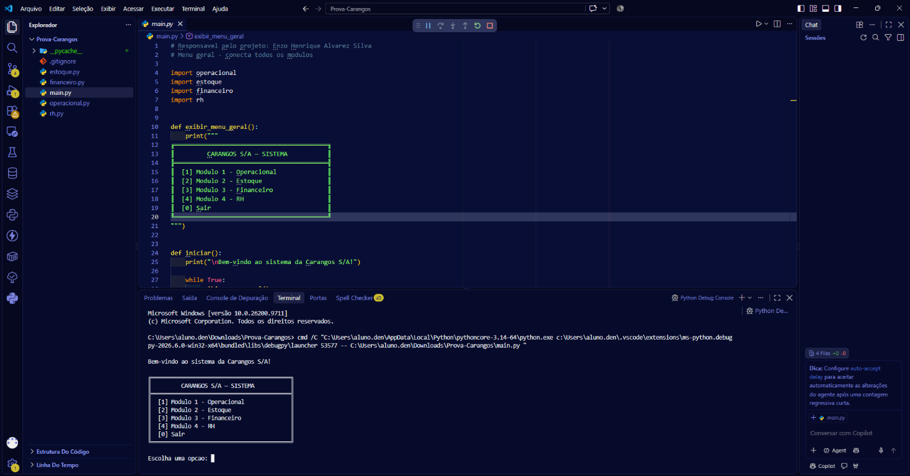

# Portfólio — Enzo Alvarez

Portfólio pessoal estático feito com HTML e CSS, inspirado no template Solid State do HTML5 UP. Para visualizar, abra `index.html` no navegador.

## Atualizar as capturas dos projetos

Cada projeto tem um quadro provisório com o nome do arquivo sugerido. Para usar uma captura:

1. Salve a imagem na pasta `images/` com o nome indicado no quadro do projeto.
2. No `index.html`, substitua o `<div class="project-preview ...">...</div>` daquele projeto por:

   ```html
   <div class="project-preview">
       
   </div>
   ```

3. Repita para os outros projetos, usando os respectivos nomes exibidos nos quadros e escrevendo uma descrição adequada no `alt`.

O estilo `.project-preview` já define o espaço da imagem e faz a captura preencher o quadro.

O retrato usado na apresentação fica em `images/enzo.jpg`.
